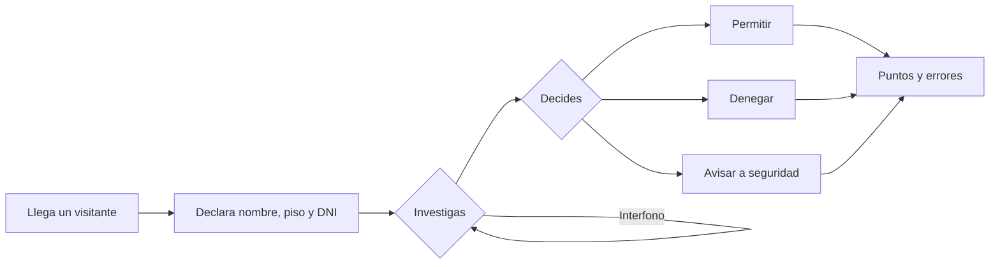

<<<<<<< HEAD
<div align="center">
=======
# Not On Record
>>>>>>> 13b07c5523e83a40c58f98d4d5fb5cc80a5880d3

# NOT ON RECORD

**Simulación · Investigación · Suspense — todo por consola**


*Inspirado en **That's Not My Neighbor** y **Papers, Please***

</div>

---

## De qué va

Eres el **conserje** de un edificio residencial. Durante una jornada van llegando visitantes que dicen vivir allí o tener motivos para entrar.

Tu trabajo: **investigar quién es quién** y decidir si los dejas pasar, les denegas la entrada o avisas a seguridad.

> ⚠️ No todo lo que parece sospechoso es culpable, ni todo el registro es fiable.

---

## Cómo se juega

Cada turno es un visitante nuevo:



1.**Llega un visitante** y declara su nombre, piso y DNI.
2.**Investigas** desde el menú: consultar el registro, pedir el DNI, hacer preguntas o llamar por interfono.
3.Cada acción puede revelar una **pista** (un dato que no cuadra).
4.**Decides**: permitir, denegar o avisar a seguridad.
5.El programa **compara tu decisión con la verdad** y actualiza puntos y errores.

###Las pistas

El impostor suplanta a un residente del registro, y algo de lo que dice no cuadra. Estas son las pistas posibles:

| # | Pista | Cómo la descubres |
|:-:|---|---|
| 1 | El DNI no coincide con el del registro | Pidiendo el DNI |
| 2 | El piso declarado es incorrecto | Consultando el registro |
| 3 | Un conviviente no lo reconoce | Llamando por interfono |
| 4 | El nombre no es el que figura en el registro | Consultando el registro |
| 5 | No sabe con quién vive | Haciéndole preguntas |

> ¡OJO! --> Hay pisos con varios residentes (pareja, madre e hija…). El teléfono es **del piso**, no de la persona: al llamar por interfono contesta quien esté en casa.

### Cómo se gana y se pierde

| | Condición |
|:-:|---|
| **Ganas** | Terminas la jornada sin llegar al máximo de errores, con la mayor puntuación posible |
| **Pierdes** | Cometes un total de **3 errores** |

Cuenta como error:
- Dejar pasar a un **impostor**.
- Denegar la entrada a un **residente legítimo**.

---

## Puntuación

| Resultado | Efecto |
|---|---|
| ✅ Acierto | **+100** puntos |
| ❌ Error | Penalización **-50** puntos, y **+1 error** |

Al final de la jornada se muestra tu **puntuación**.

---

## Estructura del proyecto

```text
NotOnRecord/
├── 📂 src/
│   └── NotOnRecord.java   # Código fuente del juego
├── 📂 lib/                   # Dependencias (esta versión no usa librerías externas)
├── 📂 bin/                   # Archivos compilados (se generan solos)
├── 📂 .vscode/
│   └── settings.json         # Ajustes del proyecto en VS Code
└── 📄 README.md
```

> Para personalizar la estructura, abre `.vscode/settings.json` y modifica los ajustes correspondientes.

---

##Cómo ejecutarlo

### Requisitos

- **JDK 17 o superior** (recomendado)
- **VS Code** con el *Extension Pack for Java*

### Pasos

1. Abre la carpeta del proyecto en VS Code.
2. Ejecuta la clase principal (`NotOnRecord`) con el botón **▶ Run**, o desde la terminal:

```bash
javac -d bin src/NotOnRecord.java
java -cp bin NotOnRecord
```

<details>
<summary>Gestión de dependencias</summary>

La vista `JAVA PROJECTS` de VS Code permite gestionar las dependencias. Más información [aquí](https://github.com/microsoft/vscode-java-dependency#manage-dependencies).

</details>

---

## Plan de desarrollo

| Evaluación | Contenido | Estado |
|:-:|---|:-:|
| **1.ª** | Versión por consola: variables, constantes, operadores, entrada/salida, estructuras de control y arrays unidimensionales | 🚧 En curso |
| **2.ª** | Programación orientada a objetos: clases, herencia, polimorfismo y excepciones | ⏳ Pendiente |
| **3.ª** | Colecciones, ficheros, base de datos y, si hay tiempo, interfaz gráfica | ⏳ Pendiente |

### Hoja de ruta de la 1.ª evaluación

- [x] Generar un visitante a partir del registro de residentes
- [x] Alterar un dato aleatorio del impostor para crear la pista
- [x] Mostrar al visitante en pantalla
- [ ] Menú de investigación (`do-while` + `switch`) con validación de opción
- [ ] Decisión final y comparación con la verdad
- [ ] Puntuación, errores y fin de partida
- [ ] Colores ANSI en la consola

---

<div align="center">

*Proyecto de 1.º de DAW*

</div>
