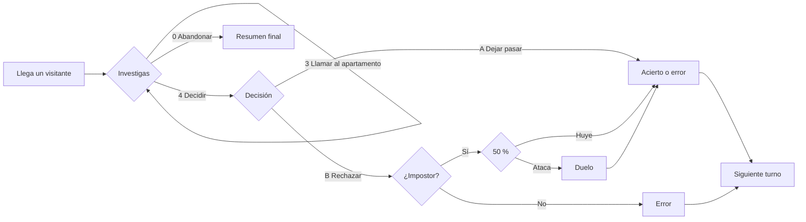

<div align="center">

# NOT ON RECORD

**Simulación · Investigación · Suspense — todo por consola**


*Inspirado en **That's Not My Neighbor** y **Papers, Please***

</div>

---

## De qué va

Eres el **portero** de un edificio residencial. Durante una jornada van llegando visitantes que dicen vivir allí y te piden que les abras.

Tu trabajo: **investigar quién es quién** y decidir si los dejas pasar o los rechazas. Si rechazas a un impostor, puede huir… o atacarte.

> ⚠️ No todo lo que parece sospechoso es culpable: el visitante puede no entregar el documento y el conviviente puede no estar en casa.

---

## Cómo se juega

Al arrancar aparece un **menú principal**: `1. Empezar partida` · `2. Cómo jugar` · `3. Salir del juego`.

Una partida son **5 turnos**, uno por visitante:



1. **Llega un visitante** y puede entregarte su documento por su cuenta (50 %), que se muestra en un recuadro tipo DNI.
2. **Investigas** con el menú de cada turno.
3. **Decides**: `A` dejar pasar o `B` rechazar la entrada.
4. El programa **compara tu decisión con la verdad** y actualiza puntos, aciertos y errores.

### Menú de cada turno

| Opción | Acción |
|:-:|---|
| **1** | Consultar el registro de residentes (nombre, piso, DNI y teléfono) |
| **2** | Pedir el documento (solo una vez por turno) |
| **3** | Llamar al apartamento (una llamada por turno) |
| **4** | Tomar decisión |
| **0** | Abandonar la jornada |

### Las pistas

El impostor suplanta a un residente del registro y **algo no cuadra**. Hay cuatro tipos:

| Tipo de impostor | Cómo lo descubres |
|---|---|
| Nombre alterado (por ejemplo, `Fron Pardo`) | Comparando el documento con el registro |
| Piso incorrecto | Comparando el documento con el registro |
| DNI con una letra de más delante | Comparando el documento con el registro |
| Documento **perfecto** | Llamando al apartamento: el conviviente dice que el residente **sí** está en casa, cuando un residente real estaría llamando a tu puerta |

> ¡OJO! → Hay pisos con varios residentes (pareja, familia…). El teléfono es **del piso**, no de la persona: al llamar contesta el conviviente, y SOLO si está en casa. Si escribes un teléfono que no es el del piso, nadie contesta.

### Decisiones

| Decisión | Visitante | Resultado |
|---|---|---|
| **A.** Dejar pasar | Residente | ✅ Acierto |
| **A.** Dejar pasar | Impostor | ❌ Error |
| **B.** Rechazar | Residente | ❌ Error |
| **B.** Rechazar | Impostor | ✅ Acierto: huye (50 %) o te ataca (50 %) y hay **duelo** |

### El duelo

Combate por turnos contra el impostor. Los dos empiezan con **100 de salud** (la tuya se mantiene entre duelos de la misma partida).

| Acción | Efecto |
|:-:|---|
| **1. Atacar** | Daño aleatorio entre 1 y 50 |
| **2. Bloquear ataque** | El siguiente golpe del impostor no te hace daño |
| **3. Pedir refuerzos** | Reducen al impostor al instante. Solo **2** por partida |

Si ganas, cuenta como acierto. Si pierdes, cuenta como error y **termina la partida**.

### Cómo se gana y se pierde

| | Condición |
|:-:|---|
| **Ganas** | Terminas los turnos sin llegar al máximo de errores, con la mayor puntuación posible |
| **Pierdes** | Cometes **3 errores** o el impostor te derrota en un duelo (`GAME OVER`) |

---

## Puntuación

| Resultado | Efecto |
|---|---|
| ✅ Acierto | **+100** puntos |
| ❌ Error | **+1 error** y penalización creciente: **-50 x nº de errores** (-50, -100, -150…) |

Al final de la jornada se muestran puntos, errores y aciertos, junto con una valoración:

| Puntos | Valoración |
|:-:|---|
| 400 o más | **EXPERTO** |
| 200 o más | **PROFESIONAL** |
| menos de 200 | **NOVATO** |

---

## Estructura del proyecto

```text
NotOnRecord/
├── 📂 src/
│   └── NotOnRecord.java   # Código fuente del juego (todo en un único main)
├── 📂 lib/                   # Dependencias (esta versión no usa librerías externas)
├── 📂 bin/                   # Archivos compilados (se generan solos)
├── 📂 .vscode/
│   └── settings.json         # Ajustes del proyecto en VS Code
└── 📄 README.md
```

> Para personalizar la estructura, abre `.vscode/settings.json` y modifica los ajustes correspondientes.

---

## Cómo ejecutarlo

### Requisitos

- **JDK 17 o superior** (el código usa `"\s"`, que requiere Java 15+)
- **VS Code** con el *Extension Pack for Java*
- Un terminal compatible con colores ANSI

### Pasos

1. Abre la carpeta del proyecto en VS Code.
2. Ejecuta la clase principal (`NotOnRecord`) con el botón **▶ Run**, o desde la terminal:

```bash
javac -d bin src/NotOnRecord.java
java -cp bin NotOnRecord
```

<details>
<summary>Gestión de dependencias</summary>

La vista `JAVA PROJECTS` de VS Code permite gestionar las dependencias. Más información [aquí](https://github.com/microsoft/vscode-java-dependency#manage-dependencies).

</details>

---

## Conceptos de la 1.ª evaluación aplicados

- Variables, constantes (`final`, en MAYÚSCULAS) y operadores aritméticos, relacionales y lógicos.
- Entrada con `BufferedReader` y salida con `println` / `printf`.
- Estructuras de control: `if`, `switch`, `for`, `while` y `do-while`.
- Arrays unidimensionales: registro en arrays paralelos, datos del visitante y letras para estropear el DNI, con recorrido, búsqueda, selección y actualización.

---

## Plan de desarrollo

| Evaluación | Contenido | Estado |
|:-:|---|:-:|
| **1.ª** | Versión por consola: variables, constantes, operadores, entrada/salida, estructuras de control y arrays unidimensionales | ✅ Completa |

### Hoja de ruta de la 1.ª evaluación

- [x] Generar un visitante a partir del registro de residentes
- [x] Alterar un dato aleatorio del impostor para crear la pista
- [x] Mostrar al visitante y su documento en pantalla
- [x] Menú de investigación (`do-while` + `switch`) con validación de opción
- [x] Llamada al apartamento con conviviente
- [x] Decisión final y comparación con la verdad
- [x] Duelo con salud, bloqueo y refuerzos
- [x] Puntuación, errores y fin de partida
- [x] Colores ANSI en la consola

---

<div align="center">

*Proyecto de 1.º de DAW*

</div>
