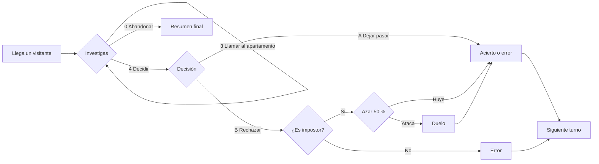

<div align="center">

# NOT ON RECORD

**Simulación · Investigación · Suspense — todo por consola**


*Inspirado en **That's Not My Neighbor** y **Papers, Please***

</div>

---

## Qué es este proyecto

**Not On Record** es un videojuego de texto que se juega en la consola, escrito en **Java** como proyecto de la asignatura de Programación de 1.º de DAW (Desarrollo de Aplicaciones Web). No tiene gráficos ni ventanas: se juega leyendo mensajes y escribiendo opciones con el teclado.

Todo el programa está en un único fichero, `src/NotOnRecord.java`, dentro del método `main`. Es intencionado: en la 1.ª evaluación solo se trabajan variables, estructuras de control y arrays, sin métodos propios ni clases (eso llega en la 2.ª evaluación, ver [plan de desarrollo](#plan-de-desarrollo)).

Además del código, el repositorio incluye en `docs/` la **memoria del proyecto en PDF**, con el diseño, la tabla de pruebas y las capturas del juego funcionando.

---

## De qué va el juego

Eres el **portero** de un edificio residencial. Durante una jornada van llegando visitantes que dicen vivir allí y te piden que les abras.

Tienes un **registro** con los residentes reales (nombre, piso, DNI y teléfono). Tu trabajo es **investigar quién es quién** y decidir si dejas pasar al visitante o lo rechazas. Algunos visitantes son **impostores** que se hacen pasar por un residente. Si rechazas a un impostor, puede huir o atacarte.

> ⚠️ No todo lo que parece sospechoso es culpable: el visitante puede no entregar el documento y la persona que vive con él puede no estar en casa.

---

## Cómo se juega

Al arrancar aparece un **menú principal**: `1. Empezar partida` · `2. Cómo jugar` · `3. Salir del juego`. La opción 2 explica las reglas dentro del propio juego.

Una partida son **5 turnos**, uno por visitante. En cada turno se elige un residente del registro **al azar**, así que el mismo residente puede aparecer en más de un turno.



1. **Llega un visitante.** Con un 50 % de probabilidad entrega su documento por su cuenta y se muestra en un recuadro con aspecto de DNI.
2. **Investigas** con el menú de cada turno.
3. **Decides**: `A` dejar pasar o `B` rechazar la entrada.
4. El programa **compara tu decisión con la verdad** y actualiza puntos, aciertos y errores.

### Menú de cada turno

| Opción | Acción |
|:-:|---|
| **1** | Consultar el registro de residentes (nombre, piso, DNI y teléfono) |
| **2** | Pedir el documento (solo una vez por turno; si ya lo entregó, te lo recuerda) |
| **3** | Llamar al apartamento (una llamada por turno) |
| **4** | Tomar decisión |
| **0** | Abandonar la jornada |

### Las pistas

El impostor suplanta a un residente del registro y **algo no cuadra**. Hay cuatro tipos:

| Tipo de impostor | Cómo lo descubres |
|---|---|
| Nombre alterado (por ejemplo, `Fron Pardo`) | Comparando el documento con el registro |
| Piso incorrecto (puede salir el piso 0, que no existe en el edificio) | Comparando el documento con el registro |
| DNI con una letra de más delante | Comparando el documento con el registro |
| Documento **perfecto** | Llamando al apartamento: el conviviente dice que el residente **sí** está en casa, cuando un residente real estaría llamando a tu puerta |

El impostor perfecto solo puede aparecer si el residente suplantado **vive con alguien**, porque si vive solo nadie contestaría a la llamada. En ese caso el programa elige otro tipo de pista.

> ¡OJO! Hay pisos con varios residentes (pareja, compañeros de piso…). El teléfono es **del piso**, no de la persona: al llamar contesta el conviviente, y solo si está en casa. Si escribes un teléfono que no es el del piso, nadie contesta.

### Decisiones

| Decisión | Visitante | Resultado |
|---|---|---|
| **A.** Dejar pasar | Residente | ✅ Acierto |
| **A.** Dejar pasar | Impostor | ❌ Error |
| **B.** Rechazar | Residente | ❌ Error |
| **B.** Rechazar | Impostor | ✅ Acierto: huye (50 %) o te ataca (50 %) y hay **duelo** |

### El duelo

Si un impostor rechazado te ataca, hay un combate por turnos. Los dos empiezan con **100 de salud**. La tuya **se mantiene entre duelos** de la misma partida; la del impostor es nueva en cada duelo. Ninguna salud baja de 0.

| Acción | Efecto |
|:-:|---|
| **1. Atacar** | Daño aleatorio entre 1 y 50 |
| **2. Bloquear ataque** | El siguiente golpe del impostor queda bloqueado y no te hace daño. **No se puede bloquear dos rondas seguidas** |
| **3. Pedir refuerzos** | Reducen al impostor al instante. Solo hay **1** por partida |

Si ganas el duelo, cuenta como acierto. Si pierdes, cuenta como error y **termina la partida**.

### Cómo se gana y se pierde

| | Condición |
|:-:|---|
| **Ganas** | Terminas los 5 turnos sin llegar a 3 errores, con la mayor puntuación posible |
| **Pierdes por errores** | Cometes **3 errores**: aparece «HAS COMETIDO DEMASIADOS ERRORES» |
| **Pierdes en un duelo** | El impostor te derrota: aparece «El impostor te ha derrotado» |
| **GAME OVER** | Se muestra al perder por cualquiera de las dos vías |

---

## Puntuación

| Resultado | Efecto |
|---|---|
| ✅ Acierto | **+100** puntos |
| ❌ Error | **+1 error** y penalización creciente: **-50 x nº de errores** (-50, -100, -150…) |

Al final de la jornada se muestran puntos, errores y aciertos, junto con una valoración:

| Puntos | Valoración |
|:-:|---|
| 400 o más | 🏆 **EXPERTO** |
| 200 o más | 👍 **PROFESIONAL** |
| menos de 200 | 🔰 **NOVATO** |

---

## Cómo ejecutarlo

### Requisitos

- **JDK 25 o compatible.** El código usa `"\s"` (espacio en un texto), que necesita Java 15 o más.
- Un terminal que muestre colores ANSI (el de VS Code, Linux o macOS lo hacen; en Windows, Windows Terminal o PowerShell actual).
- Opcional: **VS Code** con el *Extension Pack for Java*.

Para comprobar tu versión de Java:

```bash
java -version
```

### Pasos

1. Descarga o clona el repositorio:

```bash
git clone https://github.com/BiancaAMD/NotOnRecord.git
cd NotOnRecord
```

2. Compila el código. Se crea la carpeta `bin/` con el resultado:

```bash
javac -d bin src/NotOnRecord.java
```

3. Ejecuta el juego:

```bash
java -cp bin NotOnRecord
```

Si usas VS Code, también puedes abrir la carpeta y pulsar **▶ Run** sobre la clase `NotOnRecord`.

---

## Estructura del proyecto

```text
NotOnRecord/
├── src/
│   └── NotOnRecord.java                      # Código fuente del juego (todo en un único main)
├── docs/
│   └── Memoria_JuegoEV1_BiancaDomozina.pdf   # Memoria: diseño, pruebas y capturas
├── .gitignore                                # Evita subir archivos generados (*.class, bin/…)
└── README.md                                 # Este documento
```

La carpeta `bin/` aparece al compilar. Esta versión no usa librerías externas.

---

## Conceptos de la 1.ª evaluación aplicados

- Variables, constantes (`final`, en MAYÚSCULAS) y operadores aritméticos, relacionales y lógicos.
- Entrada con `BufferedReader` y salida con `println` / `printf`.
- Estructuras de control: `if`, `switch`, `for`, `while` y `do-while`.
- Arrays unidimensionales: registro en arrays paralelos (`nombres`, `pisos`, `dnis`, `telefonos`), datos del visitante y letras para estropear el DNI, con recorrido, búsqueda, selección y actualización.
- Números aleatorios con `Math.random()` para elegir residente, tipo de impostor, daño y probabilidades.

---

## Cambios de esta versión

Esta entrega **no añade funcionalidades nuevas**: corrige el código y mejora la documentación tras la revisión del profesor.

- Al rechazar a un visitante, el mensaje depende del resultado real (ya no acusa de impostor antes de comprobarlo).
- Perder por errores y perder un duelo tienen mensajes distintos.
- El bloqueo del duelo ya no se puede repetir dos rondas seguidas.
- La salud nunca baja de 0.
- Los refuerzos iniciales y otros valores fijos pasan a ser constantes con nombre.
- Se ha completado la opción **Cómo jugar** del menú.
- La memoria PDF se ha reconstruido con índice, tabla de pruebas completa y capturas numeradas.

---

## Plan de desarrollo

| Evaluación | Contenido | Estado |
|:-:|---|:-:|
| **1.ª** | Versión por consola: variables, constantes, operadores, entrada/salida, estructuras de control y arrays unidimensionales | ✅ Completa |
| **2.ª** | Programación orientada a objetos: modularización en métodos y clases (`Residente`, `Visitante`, `Impostor`…), herencia, polimorfismo y excepciones | ⏳ Pendiente |
| **3.ª** | Colecciones, ficheros, base de datos y, si hay tiempo, interfaz gráfica | ⏳ Pendiente |

### Hoja de ruta de la 1.ª evaluación

- [x] Generar un visitante a partir del registro de residentes
- [x] Alterar un dato aleatorio del impostor para crear la pista
- [x] Mostrar al visitante y su documento en pantalla
- [x] Menú de investigación (`do-while` + `switch`) con validación de opción
- [x] Llamada al apartamento con conviviente
- [x] Decisión final y comparación con la verdad
- [x] Duelo con salud, bloqueo limitado y refuerzos
- [x] Puntuación, errores y fin de partida
- [x] Colores ANSI en la consola
- [x] Opción «Cómo jugar» completa
- [x] Memoria PDF con pruebas y capturas

---

<div align="center">

*Proyecto de 1.º de DAW · Bianca Ana María Domozina*

</div>
